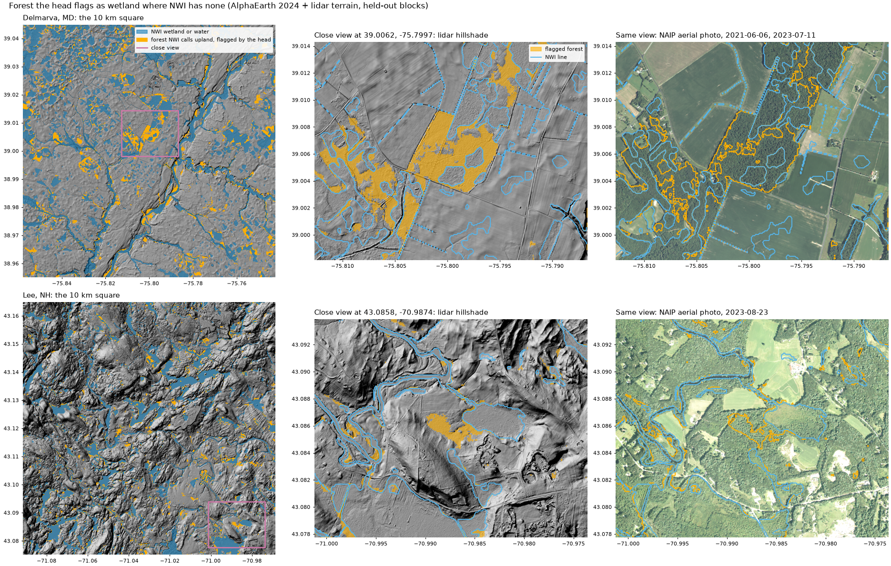

# embeddings-wetlands-finder

🤖 This README was written by Claude.

Tests of how well yearly 10 m satellite embeddings find wetlands, alone and with lidar and imagery.

Three embeddings are compared on the same pixels, all read from Source Cooperative: AlphaEarth Foundations
(64 numbers a pixel), TESSERA v1.1 (128) and OlmoEarth v1.3 (128). Labels are National Wetlands Inventory (NWI)
polygons from the USFWS map service. Lidar is USGS 3DEP: the 1 m elevation models and the raw point clouds.
Imagery is USDA NAIP aerial photography and Sentinel-2.

Three 10 km squares in different landscapes:

| Square | Landscape | NWI photo year |
|---|---|---|
| Delmarva (Maryland and Delaware) | coastal plain, forested depressions among crop fields | 2019 |
| Stutsman County, North Dakota | prairie potholes | 2019 |
| Lee, New Hampshire | glaciated forest, swamps under tree canopy | 2015 |

Every score is on ground the model was not taught on: each square is cut into 1 km blocks and the blocks are
dealt into folds, or the whole square is held out. Open water is left out of both sides, so the question is
vegetated wetland against upland.

Two numbers are reported. AUC is how often a wetland pixel outranks an upland pixel. The percentage beside it is
the share of flagged pixels that NWI calls wetland when the cutoff is set to find 80 % of the wetland.

## Summary

- Inside a square, every embedding finds vegetated wetland about equally well (AUC .95 to .98), and about 60 to
  70 % of what it flags is wetland by NWI.
- 1 m lidar terrain alone does about as well, and adding it to an embedding is the one addition that helps:
  up to +.02 AUC and 4 to 10 points of flagged pixels being wetland.
- Nothing else tested adds anything on top of an embedding with terrain: the raw lidar points, summer aerial
  photos, and leaf-off or summer Sentinel-2 all change AUC by .004 or less, which is inside the run-to-run noise.
- Carrying a head to a square it has never seen is the weak spot. The share of flagged pixels that are wetland
  falls from 72 to 76 % to 41 to 60 %.
- From a wet year to a dry year the ranking of pixels holds, but a fixed cutoff does not.
- Against the one field research site inside a square, the head taught on NWI scores .966.

## Scripts

Each script is self-contained (`uv run scripts/<name>.py`), reads everything over the network at run time and
caches nothing. The only files written are the figures and the saved heads.

| Script | Question | Time, peak memory |
|---|---|---|
| `embedding_signal.py` | Is there wetland signal in the embeddings alone? Linear probe. | 2 min, 7 GB |
| `terrain_adds.py` | Does 1 m lidar terrain add to them? Small head (one hidden layer of 64). | 15 min, 8 GB |
| `lpc_adds.py` | Do the raw lidar points add more? 5.9 billion points, 31 GB read. | 66 min, 7 GB |
| `imagery_adds.py` | Do summer aerial photos (NAIP) add more? | 25 min, 9 GB |
| `leafoff_adds.py` | Do the embeddings already hold what leaf-off Sentinel-2 shows? | 8 min, 8 GB |
| `wetland_head.py` | Does a head taught in two squares work in the third? Saves the heads. | 8 min, 10 GB |
| `wet_dry.py` | Does the signal depend on a wet or a dry year? | 5 min, 5 GB |
| `flagged_forest.py` | What is the forest the head flags and NWI calls upland? Draws the figure. | 8 min, 7 GB |
| `field_check.py` | How does the head score against a field research site's own map? | 4 min, 6 GB |
| `many_squares.py` | Does a head taught on many landscapes carry to ones it has not seen? Results pending. | 2 h, 14 GB |

`ept.py` reads the USGS public Entwine Point Tile clouds and `pc.py` reads Microsoft Planetary Computer.

## Results

### Embeddings alone

Linear probe on the 2024 embedding, AUC:

| Test | Square | AlphaEarth | TESSERA | OlmoEarth |
|---|---|---|---|---|
| Vegetated wetland vs upland | Delmarva | .950 | .952 | .952 |
| | Stutsman | .970 | .979 | .981 |
| | Lee | .953 | .944 | .966 |
| Within 30 m of the NWI line | Delmarva | .841 | .859 | .864 |
| | Stutsman | .888 | .922 | .922 |
| | Lee | .833 | .861 | .881 |
| Forested wetland vs upland forest | Delmarva | .868 | .878 | .873 |
| | Lee | .943 | .933 | .956 |

### What each added input does, inside a square

Small head, vegetated wetland vs upland. "Best embedding" is the best of the three in that square.

| Input | Delmarva | Stutsman | Lee |
|---|---|---|---|
| Terrain alone | .932 (58 %) | .976 (62 %) | .954 (59 %) |
| Points alone | .917 (53 %) | .891 (27 %) | .892 (34 %) |
| Summer aerial photos alone | .885 (45 %) | .929 (39 %) | .782 (17 %) |
| Leaf-off Sentinel-2 alone | .920 (53 %) | .909 (27 %) | .798 (19 %) |
| Summer Sentinel-2 alone | .899 (49 %) | .937 (50 %) | .761 (16 %) |
| Terrain + points, no embedding | .955 (68 %) | .980 (69 %) | .963 (66 %) |
| Best embedding alone | .954 (67 %) | .982 (71 %) | .967 (68 %) |
| Best embedding + terrain | .963 (72 %) | .986 (75 %) | .972 (72 %) |
| The same + points | .963 (72 %) | .986 (76 %) | .972 (73 %) |
| The same + summer aerial photos | .961 (71 %) | .986 (76 %) | .972 (72 %) |
| The same + leaf-off Sentinel-2 | .962 (71 %) | .986 (76 %) | .972 (73 %) |

The same fit repeated in different runs moves by about .002, so differences under .003 mean nothing.

Where the call is hardest, with the best embedding in each square:

| Test | Square | Embedding | + terrain | + terrain + points |
|---|---|---|---|---|
| Within 30 m of the NWI line | Delmarva | .861 (61 %) | .881 (65 %) | .885 (66 %) |
| | Stutsman | .927 (72 %) | .942 (74 %) | .944 (76 %) |
| | Lee | .886 (64 %) | .898 (67 %) | .901 (68 %) |
| Forested wetland vs upland forest | Delmarva | .876 (68 %) | .895 (71 %) | .893 (71 %) |
| | Lee | .956 (56 %) | .962 (61 %) | .965 (62 %) |

Leaf-off Sentinel-2 on top of an embedding alone (no terrain) changes AUC by -.004 to +.003, and the summer
composite by the same amount. The embeddings are built from the whole year's scenes, and this is consistent with
their already holding what either season shows at 10 m.

Notes on the inputs:

- Points: 38 numbers per pixel (density, returns, intensity, height above ground). The three point clouds are
  classed only into ground, water and noise, so vegetation structure comes from height above the elevation
  model, not from class codes. Intensity ranges differ widely between the three projects.
- Aerial photos: NAIP read at 2 m and reduced to eleven numbers per pixel, mostly from 2023 summer flights. Lee
  is filled in places from October 2018 and July 2014. A head that reads the image itself was not tested.
- Sentinel-2: the median of up to 12 clear scenes of 2024 per season, nine numbers per pixel.

### A head taught in two squares, scored on the third

Small head, vegetated wetland vs upland. No pixel of the scored square is seen in teaching.

| Input | Delmarva | Stutsman | Lee |
|---|---|---|---|
| Terrain | .838 (37 %) | .951 (43 %) | .936 (49 %) |
| AlphaEarth | .929 (57 %) | .913 (28 %) | .896 (33 %) |
| AlphaEarth + terrain | .930 (59 %) | .950 (40 %) | .922 (42 %) |
| TESSERA | .801 (31 %) | .877 (19 %) | .632 (13 %) |
| TESSERA + terrain | .857 (39 %) | .950 (40 %) | .897 (34 %) |
| OlmoEarth | .936 (58 %) | .886 (20 %) | .944 (55 %) |
| OlmoEarth + terrain | .938 (60 %) | .951 (41 %) | .931 (45 %) |

Terrain numbers are in meters and slopes, so they carry to the two squares with relief and not to the flat
coastal plain. TESSERA alone does not carry between these squares. Within 30 m of the NWI line the best inputs
score .75 to .84.

The heads taught on all three squares are saved in `models/` (6 to 47 KB each) with the standardization folded
into the first layer, so scoring needs only numpy:

    h = np.maximum(x @ W1 + b1, 0);  p = 1 / (1 + np.exp(-(h @ W2 + b2)))

### Wet year against dry year

The wettest and driest calendar years of 2017 to 2025 by ERA5 precipitation at each square's center: Delmarva
2018 and 2024, Stutsman 2019 and 2020, Lee 2023 and 2025. Linear probe, same held-out blocks, vegetated wetland
vs upland:

| Square | Embedding | Wet to wet | Dry to dry | Wet to dry | Dry to wet |
|---|---|---|---|---|---|
| Delmarva | AlphaEarth | .951 | .949 | .937 | .941 |
| | TESSERA | .952 | .952 | .940 | .935 |
| | OlmoEarth | .959 | .952 | .943 | .941 |
| Stutsman | AlphaEarth | .974 | .970 | .943 | .949 |
| | TESSERA | .982 | .979 | .964 | .967 |
| | OlmoEarth | .984 | .981 | .973 | .968 |
| Lee | AlphaEarth | .953 | .953 | .949 | .948 |
| | TESSERA | .946 | .947 | .909 | .910 |
| | OlmoEarth | .965 | .963 | .960 | .960 |

Ranking survives the change of year with a loss of .003 to .04. A fixed cutoff does not. The share of each NWI
kind that the wet-year probe calls wetland (probability .5 or more), shown the wet year and then the dry year:

| Square | NWI kind | AlphaEarth | TESSERA | OlmoEarth |
|---|---|---|---|---|
| Delmarva | forested/shrub | 71 % to 30 % | 68 % to 94 % | 71 % to 89 % |
| | upland | 5 % to 2 % | 5 % to 19 % | 5 % to 14 % |
| Stutsman | emergent | 64 % to 8 % | 72 % to 56 % | 72 % to 70 % |
| | upland | 1 % to 0 % | 1 % to 1 % | 1 % to 2 % |
| Lee | forested/shrub | 55 % to 56 % | 54 % to 96 % | 61 % to 60 % |
| | upland | 2 % to 2 % | 2 % to 48 % | 2 % to 2 % |

A calendar year's rain is a rough stand-in for how wet the ground was, and the two years of a pair differ in
more than rain.

### Forest the head flags and NWI calls upland

AlphaEarth 2024 with terrain, held-out blocks, cutoff at 80 % of NWI's vegetated wetland found.

| | Delmarva | Lee |
|---|---|---|
| Upland forest by NWI | 2,687 ha | 7,430 ha |
| Of that, flagged | 513 ha (19 %) | 292 ha (3.9 %) |
| Flagged within 30 m of the NWI line | 55 % | 72 % |
| Flagged over 100 m from it | 11 % | 9 % |
| Patches of 0.5 ha or more, mostly over 30 m from NWI | 86 (231 ha) | 25 (35 ha) |

Share of pixels on soil map units that are at least half hydric (USDA soil survey, gNATSGO):

| Forest group | Delmarva | Lee |
|---|---|---|
| Upland by NWI, flagged | 59 % | 56 % |
| Upland by NWI, not flagged | 26 % | 15 % |
| NWI forested/shrub wetland | 82 % | 72 % |

Most of the flagged forest lies along NWI's line. The rest sits on hydric soil two to four times as often as
unflagged upland forest, which is what wetland missed under canopy would look like, and also what a head that
leans on low ground would produce: terrain is one of its inputs, and soil maps follow terrain too.

### Against a field research site

The USGS Cottonwood Lake Study Area lies inside the Stutsman square: 91 ha with yearly maps of the vegetation
zones of 17 pothole wetlands, drawn by the site's crew from low-altitude photographs tied to GPS ground control
(Mushet and others 2017, doi:10.5066/F7J101DQ). The 2015 map is scored against 2017 embeddings, the earliest year.

| Input | AUC vs site map | AUC vs NWI, same pixels |
|---|---|---|
| Terrain | .965 | .983 |
| AlphaEarth | .946 | .965 |
| AlphaEarth + terrain | .966 | .986 |
| TESSERA + terrain | .967 | .983 |
| OlmoEarth + terrain | .966 | .990 |

NWI itself has a polygon on 71 % of the site's wetland pixels and on 3 % of its upland pixels. At the 80 % cutoff
the heads flag 61 to 73 % of the site's wetland and 3 to 4 % of its upland. This is 913 wetland pixels at one
site, and ground inside the study boundary and outside every mapped zone is assumed to be upland.

No public field-delineated wetland boundaries were found inside the Delmarva or Lee squares.

## What these numbers do not show

- The labels are NWI, so almost every score is agreement with NWI. A wetland NWI missed counts as upland here.
  The one check against a field site covers 1 km2 of prairie potholes.
- Three squares. The scores differ by landscape and a head taught in two does not carry cleanly to the third.
  Whether more squares to teach from would close that gap is not yet tested.
- NWI's line is least exact at the boundary, which is also where the scores are lowest.
- Each number is a single fit. Differences of a few thousandths between inputs are inside the noise.
