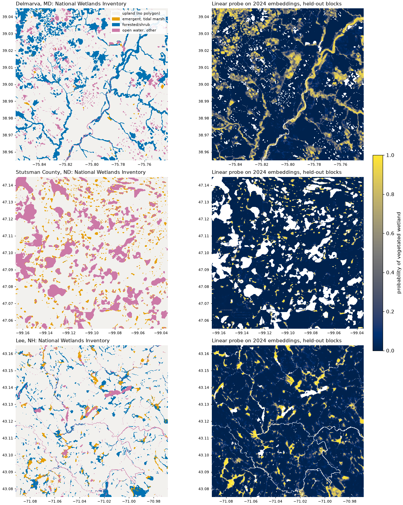

# embeddings-wetlands-finder

🤖 This README was written by Claude.

Tests of how well yearly 10 m satellite embeddings find wetlands, alone and with lidar and imagery.

Three embeddings are compared on the same pixels, all read from Source Cooperative: AlphaEarth Foundations
(64 numbers a pixel), TESSERA v1.1 (128) and OlmoEarth v1.3 (128). Labels are National Wetlands Inventory (NWI)
polygons from the USFWS map service. Lidar is USGS 3DEP: the 1 m elevation models and the raw point clouds.
Imagery is USDA NAIP aerial photography and Sentinel-2.

Three 10 km squares in different landscapes:

| Square | Landscape | NWI photo year |
|---|---|---|
| Delmarva (Maryland and Delaware) | coastal plain, forested depressions among crop fields | 2019 |
| Stutsman County, North Dakota | prairie potholes | 2019 |
| Lee, New Hampshire | glaciated forest, swamps under tree canopy | 2015 |

Every score is on ground the model was not taught on: each square is cut into 1 km blocks and the blocks are
dealt into folds, or the whole square is held out. Open water is left out of both sides, so the question is
vegetated wetland against upland.

Two numbers are reported. AUC is how often a wetland pixel outranks an upland pixel. The percentage beside it is
the share of flagged pixels that NWI calls wetland when the cutoff is set to find 80 % of the wetland.

## Summary

- Inside a square, every embedding finds vegetated wetland about equally well (AUC .95 to .98), and about 60 to
  70 % of what it flags is wetland by NWI.
- 1 m lidar terrain alone does about as well, and adding it to an embedding is the one addition that helps:
  up to +.02 AUC and 4 to 10 points of flagged pixels being wetland.
- Nothing else tested adds anything on top of an embedding with terrain: the raw lidar points, summer and October
  aerial photos, and leaf-off or summer Sentinel-2 all change AUC by .004 or less, which is inside the run-to-run
  noise.
- A small network that reads the elevation itself, in place of eleven summaries of it, does a little better:
  +.001 to +.005 AUC on top of an embedding inside a square, and more in the flat Delmarva square and under its
  trees (+.014 to +.021). Across squares it helps with AlphaEarth and not consistently with OlmoEarth.
  Taught on 46 squares it adds nothing on top of an embedding in the median square (+.001 or less), and +.010
  with no embedding.
- The lidar point numbers do not carry between squares: alone they score near chance in two of three, and on
  top of an embedding with terrain they help in one square and hurt in another.
- Carrying a head to a square it has never seen is the weak spot. The share of flagged pixels that are wetland
  falls from 72 to 76 % to 41 to 60 %.
- Teaching on more landscapes closes most of that gap. With 46 squares across the lower 48 states, a head scored
  on squares it never saw reaches a median AUC of .95, and 79 % of what it flags is wetland by NWI. The spread
  between squares stays wide (.82 to .996).
- From a wet year to a dry year the ranking of pixels holds, but a fixed cutoff does not.
- Against the one field research site inside a square, the head taught on NWI scores .966.
- A three-class head (upland, vegetated wetland, open water) taught on 76 squares from AlphaEarth alone holds up
  on squares it never saw: median wetland AUC .925, water AUC .936. It is weak in the arid West and in ordinary
  landscapes with little wetland.
- Small wetlands are where it falls short. Against four states' finer wetland maps, that head finds 23 to 50 % of
  the wetlands under 2 acres when 5 % of dry ground is flagged.
- Finer labels alone barely change that. Elevation does: a head taught inside the state with AlphaEarth and eleven
  terrain numbers from 1 m lidar finds 49 to 85 % of them at the same price.
- The national 10 m elevation model gives the same lift as 1 m lidar in Vermont and Massachusetts and most of it
  in New Jersey and Delaware, so the gain does not depend on lidar coverage.
- That lift carries to a national head. One head taught on the 76 squares with AlphaEarth and the 10 m terrain
  numbers finds 39 to 70 % of the wetlands under 2 acres in the four states, against 23 to 50 % without elevation,
  at the same 5 % of dry ground flagged. Against NWI in held-out squares the gain is small (median wetland AUC
  .925 to .943), and one square of rice fields gets much worse.

## Scripts

Each script is self-contained (`uv run scripts/<name>.py`), reads everything over the network at run time and
caches nothing. The only files written are the figures and the saved heads.

| Script | Question | Time, peak memory |
|---|---|---|
| `embedding_signal.py` | Is there wetland signal in the embeddings alone? Linear probe. | 2 min, 7 GB |
| `terrain_adds.py` | Does 1 m lidar terrain add to them? Small head (one hidden layer of 64). | 15 min, 8 GB |
| `lpc_adds.py` | Do the raw lidar points add more, inside a square and across squares? 5.9 billion points, 31 GB read. | 66 min with two workers, 17 GB |
| `imagery_adds.py` | Do summer aerial photos (NAIP) add more? | 25 min, 9 GB |
| `leafoff_adds.py` | Do the embeddings already hold what leaf-off Sentinel-2 shows? | 8 min, 8 GB |
| `wetland_head.py` | Does a head taught in two squares work in the third? Saves the heads. | 8 min, 10 GB |
| `wet_dry.py` | Does the signal depend on a wet or a dry year? | 5 min, 5 GB |
| `flagged_forest.py` | What is the forest the head flags and NWI calls upland? Draws the figure. | 8 min, 7 GB |
| `field_check.py` | How does the head score against a field research site's own map? | 4 min, 6 GB |
| `patch_head.py` | Does a network that reads the elevation itself beat the eleven terrain summaries? | 63 min, 13 GB |
| `naip_leafoff.py` | Do October aerial photos find wetland under trees where summer photos do not? | 15 min, 8 GB |
| `many_squares.py` | Does a head taught on many landscapes carry to ones it has not seen? 46 squares. | 80 min, 5 GB |
| `many_pictures.py` | Does reading the elevation itself still beat the summaries when taught on 46 squares? | 87 min, 20 GB |
| `water_head.py` | Can one head tell upland, vegetated wetland and open water apart? 76 squares. Saves the head. | 32 min, 4 GB |
| `small_wetlands.py` | How many wetlands of each size does the saved head find in Vermont's finer map? | 1 min, 2 GB |
| `fine_labels.py` | Do finer state labels, or elevation, let a head find small wetlands? Four states, 66 squares. | 66 min, 11 GB (1 m lidar); 36 min, 10 GB (`--elev 10m`) |
| `national_elev.py` | Does 10 m elevation help one national head, on NWI pixels and on small wetlands? 76 squares. Saves the head. | 57 min, 9 GB |

`ept.py` reads the USGS public Entwine Point Tile clouds and `pc.py` reads Microsoft Planetary Computer.
`nwi_tiles.py` reads NWI polygons from the PMTiles copy on Source Cooperative, and `export_head.py` writes a
saved head as JSON for the browser map in `web/`.

## Results

### Embeddings alone

Linear probe on the 2024 embedding, AUC:

| Test | Square | AlphaEarth | TESSERA | OlmoEarth |
|---|---|---|---|---|
| Vegetated wetland vs upland | Delmarva | .950 | .952 | .952 |
| | Stutsman | .970 | .979 | .981 |
| | Lee | .953 | .944 | .966 |
| Within 30 m of the NWI line | Delmarva | .841 | .859 | .864 |
| | Stutsman | .888 | .922 | .922 |
| | Lee | .833 | .861 | .881 |
| Forested wetland vs upland forest | Delmarva | .868 | .878 | .873 |
| | Lee | .943 | .933 | .956 |

### What each added input does, inside a square

Small head, vegetated wetland vs upland. "Best embedding" is the best of the three in that square.

| Input | Delmarva | Stutsman | Lee |
|---|---|---|---|
| Terrain alone | .932 (58 %) | .976 (62 %) | .954 (59 %) |
| Points alone | .917 (53 %) | .891 (27 %) | .892 (34 %) |
| Summer aerial photos alone | .885 (45 %) | .929 (39 %) | .782 (17 %) |
| Leaf-off Sentinel-2 alone | .920 (53 %) | .909 (27 %) | .798 (19 %) |
| Summer Sentinel-2 alone | .899 (49 %) | .937 (50 %) | .761 (16 %) |
| Terrain + points, no embedding | .955 (68 %) | .980 (69 %) | .963 (66 %) |
| Best embedding alone | .954 (67 %) | .982 (71 %) | .967 (68 %) |
| Best embedding + terrain | .963 (72 %) | .986 (75 %) | .972 (72 %) |
| The same + points | .963 (72 %) | .986 (76 %) | .972 (73 %) |
| The same + summer aerial photos | .961 (71 %) | .986 (76 %) | .972 (72 %) |
| The same + leaf-off Sentinel-2 | .962 (71 %) | .986 (76 %) | .972 (73 %) |

The same fit repeated in different runs moves by about .002, so differences under .003 mean nothing.

Where the call is hardest, with the best embedding in each square:

| Test | Square | Embedding | + terrain | + terrain + points |
|---|---|---|---|---|
| Within 30 m of the NWI line | Delmarva | .861 (61 %) | .881 (65 %) | .885 (66 %) |
| | Stutsman | .927 (72 %) | .942 (74 %) | .944 (76 %) |
| | Lee | .886 (64 %) | .898 (67 %) | .901 (68 %) |
| Forested wetland vs upland forest | Delmarva | .876 (68 %) | .895 (71 %) | .893 (71 %) |
| | Lee | .956 (56 %) | .962 (61 %) | .965 (62 %) |

Leaf-off Sentinel-2 on top of an embedding alone (no terrain) changes AUC by -.004 to +.003, and the summer
composite by the same amount. The embeddings are built from the whole year's scenes, and this is consistent with
their already holding what either season shows at 10 m.

Notes on the inputs:

- Points: 38 numbers per pixel (density, returns, intensity, height above ground). The three point clouds are
  classed only into ground, water and noise, so vegetation structure comes from height above the elevation
  model, not from class codes. Intensity ranges differ widely between the three projects. All 5.9 billion points
  over the three squares were read with no failed nodes. Points fall on 99.8 % of pixels in Delmarva and Lee and
  90.6 % in Stutsman (81.5 % with a ground return), where open water returns little. Across squares the
  point numbers do not carry (see the head taught in two squares).
- Aerial photos: NAIP read at 2 m and reduced to eleven numbers per pixel, mostly from 2023 summer flights. Lee
  is filled in places from October 2018 and July 2014. A network that reads the photo itself was not tested.
- Sentinel-2: the median of up to 12 clear scenes of 2024 per season, nine numbers per pixel.

### Reading the elevation itself

In place of the eleven terrain summaries, a small convolutional network reads two 64 x 64 pictures of the
elevation around each pixel, as height against the pixel's own ground: one of 2 m cells (128 m across) and one of
10 m cells (640 m across). "Summaries" is the small head on the eleven numbers; "pictures" is the network. Same
pixels and held-out blocks for both.

Inside a square, vegetated wetland vs upland:

| Input | Delmarva | Stutsman | Lee |
|---|---|---|---|
| Summaries | .932 (58 %) | .976 (62 %) | .954 (59 %) |
| Pictures | .957 (71 %) | .977 (61 %) | .957 (60 %) |
| AlphaEarth + summaries | .960 (70 %) | .983 (71 %) | .969 (71 %) |
| AlphaEarth + pictures | .965 (74 %) | .984 (71 %) | .971 (71 %) |
| OlmoEarth + summaries | .960 (70 %) | .986 (75 %) | .971 (73 %) |
| OlmoEarth + pictures | .966 (74 %) | .987 (76 %) | .974 (74 %) |

Where the call is hardest, inside a square:

| Test | Square | AlphaEarth + summaries | + pictures | OlmoEarth + summaries | + pictures |
|---|---|---|---|---|---|
| Within 30 m of the NWI line | Delmarva | .877 | .885 | .879 | .890 |
| | Stutsman | .932 | .933 | .942 | .944 |
| | Lee | .886 | .890 | .896 | .900 |
| Forested wetland vs upland forest | Delmarva | .893 | .907 | .891 | .912 |
| | Lee | .961 | .965 | .962 | .967 |

Taught on the other two squares, scored on the third:

| Input | Delmarva | Stutsman | Lee |
|---|---|---|---|
| Summaries | .838 (37 %) | .951 (43 %) | .936 (49 %) |
| Pictures | .861 (39 %) | .954 (48 %) | .946 (53 %) |
| AlphaEarth + summaries | .930 (59 %) | .950 (40 %) | .922 (42 %) |
| AlphaEarth + pictures | .938 (62 %) | .962 (49 %) | .945 (54 %) |
| OlmoEarth + summaries | .938 (60 %) | .951 (41 %) | .931 (45 %) |
| OlmoEarth + pictures | .948 (65 %) | .947 (40 %) | .938 (49 %) |

The pictures gain most in Delmarva, the flat square, where the summaries were weakest. Inside a square most of
the other gains are near the .002 run-to-run noise. Each number is one fit of a network with one set of choices
(picture size, depth, eight epochs); none of them was tuned.

### Reading the elevation itself, taught on many squares

The same network and the same two pictures, with the 46 squares of the many-squares test in place of three:
16,000 pixels kept per square, squares dealt into six folds, each square scored by a head taught only on the
other folds' squares. Median over the 46 held-out squares, lowest to highest in brackets.

| Input | AUC | Flagged that is wetland | Within 30 m | Forest |
|---|---|---|---|---|
| Summaries | .919 (.667 to .982) | 61 % | .724 | .907 |
| Pictures | .924 (.760 to .992) | 66 % | .726 | .912 |
| AlphaEarth + summaries | .952 (.772 to .996) | 78 % | .766 | .931 |
| AlphaEarth + pictures | .953 (.836 to .997) | 79 % | .764 | .939 |
| OlmoEarth + summaries | .951 (.616 to .997) | 76 % | .758 | .933 |
| OlmoEarth + pictures | .952 (.666 to .996) | 76 % | .767 | .932 |

Squares where pictures beat summaries:

| Input | AUC | Flagged that is wetland |
|---|---|---|
| No embedding | 38 of 46, median +.010 | 40 of 46, median +4 points |
| With AlphaEarth | 30 of 46, median +.001 | 28 of 46, median 0 |
| With OlmoEarth | 26 of 46, median .000 | 25 of 46, median 0 |

With no embedding the pictures are better in most squares, by a little. On top of an embedding the median square
does not change, so the gain seen across the three squares above does not hold up over 46. What the pictures do
change is the worst case with AlphaEarth: the lowest score rises from .772 to .836, because Merced, California
(1 % of the land is wetland) goes from .772 to .840. Single squares move both ways by more than the median: Sandhills +.043 and
Cheyenne Bottoms -.043 with OlmoEarth. One fit each, nothing tuned.

### October aerial photos over Lee

NAIP is flown in summer nearly everywhere. Over the Lee square two flights were late, 16 and 26 October 2018 and
24 October 2021, when much of the hardwood canopy has turned or dropped (oak and beech still hold leaves). Same
eleven numbers per pixel as the summer photos, same pixels for every flight.

| Input | Wetland vs upland | Within 30 m | Forested vs upland forest |
|---|---|---|---|
| August 2023 alone | .782 (17 %) | .708 | .728 (13 %) |
| October 2018 alone | .847 (25 %) | .784 | .832 (20 %) |
| October 2021 alone | .857 (26 %) | .792 | .836 (20 %) |
| August 2023 + October 2021 | .876 (30 %) | .807 | .857 (23 %) |
| Terrain | .954 (59 %) | .859 | .946 (49 %) |
| Terrain + October 2021 | .958 (62 %) | .870 | .949 (51 %) |
| OlmoEarth + terrain | .971 (73 %) | .896 | .962 (61 %) |
| OlmoEarth + terrain + October 2021 | .971 (72 %) | .896 | .964 (61 %) |

Alone, the October photos see much more than the August ones, most of all under trees (.73 to .84). On top of an
embedding with terrain they add nothing, the same as every other image input tried.

### A head taught in two squares, scored on the third

Small head, vegetated wetland vs upland. No pixel of the scored square is seen in teaching.

| Input | Delmarva | Stutsman | Lee |
|---|---|---|---|
| Terrain | .838 (37 %) | .951 (43 %) | .936 (49 %) |
| AlphaEarth | .929 (57 %) | .913 (28 %) | .896 (33 %) |
| AlphaEarth + terrain | .930 (59 %) | .950 (40 %) | .922 (42 %) |
| TESSERA | .801 (31 %) | .877 (19 %) | .632 (13 %) |
| TESSERA + terrain | .857 (39 %) | .950 (40 %) | .897 (34 %) |
| OlmoEarth | .936 (58 %) | .886 (20 %) | .944 (55 %) |
| OlmoEarth + terrain | .938 (60 %) | .951 (41 %) | .931 (45 %) |

Terrain numbers are in meters and slopes, so they carry to the two squares with relief and not to the flat
coastal plain. TESSERA alone does not carry between these squares. Within 30 m of the NWI line the best inputs
score .75 to .84.

Lidar points across squares. The same test with the 38 point numbers added, on the pixels that have points.
"Own scale" rescales every point number inside its own square before teaching, since intensity and density
differ between the three flights.

| Input | Delmarva | Stutsman | Lee |
|---|---|---|---|
| Terrain | .853 (39 %) | .953 (43 %) | .931 (47 %) |
| Points | .476 (15 %) | .804 (12 %) | .541 (10 %) |
| Points, own scale | .666 (19 %) | .364 (5 %) | .553 (11 %) |
| Terrain + points | .878 (44 %) | .953 (48 %) | .879 (32 %) |
| AlphaEarth + terrain | .934 (61 %) | .950 (40 %) | .945 (53 %) |
| AlphaEarth + terrain + points | .924 (60 %) | .961 (50 %) | .894 (34 %) |
| The same, own scale | .932 (60 %) | .946 (39 %) | .931 (46 %) |
| OlmoEarth + terrain | .942 (61 %) | .940 (35 %) | .916 (39 %) |
| OlmoEarth + terrain + points | .939 (61 %) | .957 (46 %) | .910 (37 %) |
| The same, own scale | .937 (61 %) | .919 (29 %) | .924 (43 %) |

Points alone do not carry between squares: near chance in Delmarva and Lee, and rescaling inside each square
turns Stutsman from .80 to .36, below chance. On top of an embedding with terrain they help in Stutsman (+.011
to +.017, 10 points more of flagged pixels being wetland) and hurt in Lee (-.006 to -.051). Rescaling does not
fix it; it trades the Stutsman gain for part of the Lee loss. The rows without points differ from the table
above by up to .02 for the same inputs (a second fit, on slightly fewer pixels), so across squares only
differences well over .02 mean anything.

The heads taught on all three squares are saved in `models/` (6 to 47 KB each) with the standardization folded
into the first layer, so scoring needs only numpy:

    h = np.maximum(x @ W1 + b1, 0);  p = 1 / (1 + np.exp(-(h @ W2 + b2)))

### Many squares

Sixty candidate 10 km squares across the lower 48 states; 46 were kept. The rest had too little or too much
vegetated wetland by NWI (under 1 % or over 85 % of the land), gaps in the 1 m elevation, or a map service that
failed. Each kept square gives 50,000 pixels. The squares are dealt into six folds, and every score below is for
a square whose pixels the head never saw. AlphaEarth and OlmoEarth only.

Median over the 46 held-out squares, with the lowest and highest square:

| Input | AUC | Flagged that is wetland | AUC within 30 m | AUC, forest |
|---|---|---|---|---|
| Terrain | .914 (.665 to .980) | 61 % (3 to 97) | .718 | .893 |
| AlphaEarth | .936 (.791 to .994) | 71 % (2 to 100) | .717 | .919 |
| AlphaEarth + terrain | .951 (.824 to .996) | 79 % (3 to 100) | .751 | .934 |
| OlmoEarth | .938 (.772 to .995) | 73 % (3 to 100) | .728 | .914 |
| OlmoEarth + terrain | .948 (.775 to .997) | 75 % (4 to 100) | .760 | .929 |

The share of flagged pixels that are wetland follows how much wetland a square has: it is 3 % in Merced, CA, where
1 % of the land is wetland, and 100 % in the Mobile-Tensaw delta, where 73 % is. For the three original squares,
taught on the other landscapes: Delmarva .950 (66 %), Stutsman .976 (61 %), Lee .954 (57 %) with AlphaEarth and
terrain, against .930 (59 %), .950 (40 %) and .922 (42 %) when the head was taught on just the other two.

How many squares to teach from, with the number of taught pixels held at 96,000. Median over held-out squares:

| | 2 squares | 5 squares | 10 squares | All (about 38) |
|---|---|---|---|---|
| AlphaEarth + terrain, AUC | .884 | .934 | .942 | .951 |
| lowest square | .395 | .742 | .833 | .818 |
| flagged that is wetland | 56 % | 65 % | 75 % | 79 % |
| OlmoEarth + terrain, AUC | .892 | .919 | .942 | .947 |
| lowest square | .481 | .721 | .761 | .789 |
| flagged that is wetland | 55 % | 65 % | 76 % | 74 % |

Most of the gain comes by ten squares. The worst square improves the most.

One year against four years (2018, 2020, 2022, 2024) of embeddings in teaching. The cutoff is set once, where the
head finds 80 % of the wetland it was taught on, and then applied to each year of every held-out square:

| Input | Taught on | AUC | Wetland found | Spread over years | Worst square |
|---|---|---|---|---|---|
| AlphaEarth + terrain | one year | .954 | 61 % | 12 % | 40 % |
| | four years | .954 | 68 % | 9 % | 32 % |
| OlmoEarth + terrain | one year | .949 | 61 % | 15 % | 56 % |
| | four years | .954 | 62 % | 11 % | 31 % |

Teaching on four years does not change the ranking and makes a fixed cutoff somewhat steadier from year to year.
In a square it has not seen, a cutoff meant to find 80 % finds 61 to 68 %.

The USDA soil survey as a second answer key (gNATSGO; a map unit at least half hydric counts as hydric soil):

| Input | AUC vs NWI | AUC vs hydric soil | AUC where both agree |
|---|---|---|---|
| Terrain | .912 | .835 | .948 |
| AlphaEarth + terrain | .951 | .869 | .979 |
| OlmoEarth + terrain | .946 | .859 | .978 |

| Pixels | Share of all | Flagged, AlphaEarth + terrain |
|---|---|---|
| NWI wetland on hydric soil | 20 % | 85 % |
| NWI wetland, soil not hydric | 6 % | 64 % |
| NWI upland on hydric soil | 15 % | 20 % |
| NWI upland, soil not hydric | 60 % | 6 % |

Where NWI and the soil survey agree, the heads score .98. Upland by NWI on hydric soil is flagged three times as
often as upland on other soil. That group holds both wetland NWI missed and drained or farmed hydric soil that is
no longer wetland, and these numbers do not tell the two apart.

Every square: AUC (share of flagged pixels that are wetland)

| Square | Wetland share | Terrain | AlphaEarth + terrain | OlmoEarth + terrain |
|---|---|---|---|---|
| Delmarva, MD | 16 % | .901 (49 %) | .950 (66 %) | .950 (66 %) |
| Stutsman County, ND | 6 % | .959 (47 %) | .976 (61 %) | .977 (64 %) |
| Lee, NH | 10 % | .949 (56 %) | .954 (57 %) | .951 (56 %) |
| Francis Marion, SC | 51 % | .829 (73 %) | .904 (84 %) | .905 (85 %) |
| Okefenokee edge, GA | 37 % | .831 (61 %) | .934 (84 %) | .928 (82 %) |
| Green Swamp, FL | 53 % | .850 (77 %) | .959 (95 %) | .960 (96 %) |
| Reelfoot, TN | 15 % | .954 (68 %) | .977 (92 %) | .974 (86 %) |
| Atchafalaya edge, LA | 65 % | .851 (85 %) | .938 (94 %) | .944 (94 %) |
| Brazoria, TX | 10 % | .695 (14 %) | .881 (37 %) | .821 (23 %) |
| Rainwater Basin, NE | 2 % | .912 (8 %) | .945 (14 %) | .946 (14 %) |
| Sandhills, NE | 9 % | .940 (44 %) | .984 (81 %) | .979 (75 %) |
| Prairie Coteau, SD | 3 % | .912 (19 %) | .924 (21 %) | .925 (21 %) |
| Itasca County, MN | 22 % | .955 (84 %) | .957 (86 %) | .965 (89 %) |
| Luce County, MI | 28 % | .952 (84 %) | .982 (96 %) | .978 (96 %) |
| Kankakee, IN | 9 % | .874 (28 %) | .953 (51 %) | .949 (51 %) |
| Adirondacks, NY | 14 % | .944 (64 %) | .961 (70 %) | .965 (74 %) |
| Penobscot, ME | 21 % | .950 (75 %) | .960 (82 %) | .958 (81 %) |
| Plymouth County, MA | 31 % | .923 (73 %) | .945 (79 %) | .944 (80 %) |
| Pine Barrens, NJ | 34 % | .864 (65 %) | .965 (93 %) | .967 (93 %) |
| Poconos, PA | 14 % | .922 (53 %) | .951 (67 %) | .936 (60 %) |
| Canaan Valley, WV | 18 % | .966 (78 %) | .972 (86 %) | .951 (72 %) |
| Flathead Valley, MT | 16 % | .790 (30 %) | .824 (33 %) | .803 (32 %) |
| Merced, CA | 1 % | .796 (3 %) | .853 (3 %) | .854 (4 %) |
| Roscommon, MI | 48 % | .884 (78 %) | .933 (88 %) | .943 (91 %) |
| Sampson County, NC | 13 % | .947 (63 %) | .956 (66 %) | .954 (65 %) |
| Bladen County, NC | 35 % | .837 (59 %) | .928 (78 %) | .918 (77 %) |
| Wicomico, MD | 16 % | .834 (33 %) | .954 (67 %) | .959 (70 %) |
| Sussex County, DE | 13 % | .783 (24 %) | .906 (43 %) | .897 (41 %) |
| Osceola, FL | 26 % | .863 (54 %) | .948 (83 %) | .932 (80 %) |
| Tensas, LA | 78 % | .665 (81 %) | .930 (96 %) | .856 (90 %) |
| Mobile-Tensaw, AL | 73 % | .946 (96 %) | .996 (100 %) | .997 (100 %) |
| Big Thicket, TX | 8 % | .812 (17 %) | .857 (21 %) | .845 (20 %) |
| Kidder County, ND | 8 % | .955 (51 %) | .971 (60 %) | .968 (56 %) |
| Day County, SD | 10 % | .960 (60 %) | .975 (72 %) | .975 (73 %) |
| Polk County, MN | 11 % | .947 (58 %) | .952 (59 %) | .962 (64 %) |
| Cheyenne Bottoms, KS | 41 % | .916 (78 %) | .951 (87 %) | .929 (82 %) |
| Horicon, WI | 48 % | .980 (97 %) | .993 (100 %) | .995 (100 %) |
| Tug Hill, NY | 30 % | .936 (79 %) | .943 (80 %) | .946 (82 %) |
| Montezuma, NY | 38 % | .925 (82 %) | .915 (77 %) | .939 (84 %) |
| Washington County, ME | 11 % | .939 (54 %) | .956 (63 %) | .958 (65 %) |
| Great Swamp, NJ | 38 % | .931 (82 %) | .959 (88 %) | .961 (89 %) |
| Klamath Basin, OR | 4 % | .918 (17 %) | .940 (23 %) | .947 (24 %) |
| Teton Valley, ID | 47 % | .815 (67 %) | .962 (94 %) | .945 (91 %) |
| Sacramento Valley, CA | 45 % | .688 (55 %) | .955 (91 %) | .775 (61 %) |
| Grays Harbor, WA | 12 % | .872 (37 %) | .951 (60 %) | .953 (62 %) |
| Centennial Valley, MT | 37 % | .871 (66 %) | .930 (80 %) | .947 (85 %) |

### Wet year against dry year

The wettest and driest calendar years of 2017 to 2025 by ERA5 precipitation at each square's center: Delmarva
2018 and 2024, Stutsman 2019 and 2020, Lee 2023 and 2025. Linear probe, same held-out blocks, vegetated wetland
vs upland:

| Square | Embedding | Wet to wet | Dry to dry | Wet to dry | Dry to wet |
|---|---|---|---|---|---|
| Delmarva | AlphaEarth | .951 | .949 | .937 | .941 |
| | TESSERA | .952 | .952 | .940 | .935 |
| | OlmoEarth | .959 | .952 | .943 | .941 |
| Stutsman | AlphaEarth | .974 | .970 | .943 | .949 |
| | TESSERA | .982 | .979 | .964 | .967 |
| | OlmoEarth | .984 | .981 | .973 | .968 |
| Lee | AlphaEarth | .953 | .953 | .949 | .948 |
| | TESSERA | .946 | .947 | .909 | .910 |
| | OlmoEarth | .965 | .963 | .960 | .960 |

Ranking survives the change of year with a loss of .003 to .04. A fixed cutoff does not. The share of each NWI
kind that the wet-year probe calls wetland (probability .5 or more), shown the wet year and then the dry year:

| Square | NWI kind | AlphaEarth | TESSERA | OlmoEarth |
|---|---|---|---|---|
| Delmarva | forested/shrub | 71 % to 30 % | 68 % to 94 % | 71 % to 89 % |
| | upland | 5 % to 2 % | 5 % to 19 % | 5 % to 14 % |
| Stutsman | emergent | 64 % to 8 % | 72 % to 56 % | 72 % to 70 % |
| | upland | 1 % to 0 % | 1 % to 1 % | 1 % to 2 % |
| Lee | forested/shrub | 55 % to 56 % | 54 % to 96 % | 61 % to 60 % |
| | upland | 2 % to 2 % | 2 % to 48 % | 2 % to 2 % |

A calendar year's rain is a rough stand-in for how wet the ground was, and the two years of a pair differ in
more than rain.

### Forest the head flags and NWI calls upland

AlphaEarth 2024 with terrain, held-out blocks, cutoff at 80 % of NWI's vegetated wetland found.

| | Delmarva | Lee |
|---|---|---|
| Upland forest by NWI | 2,687 ha | 7,430 ha |
| Of that, flagged | 513 ha (19 %) | 292 ha (3.9 %) |
| Flagged within 30 m of the NWI line | 55 % | 72 % |
| Flagged over 100 m from it | 11 % | 9 % |
| Patches of 0.5 ha or more, mostly over 30 m from NWI | 86 (231 ha) | 25 (35 ha) |

Share of pixels on soil map units that are at least half hydric (USDA soil survey, gNATSGO):

| Forest group | Delmarva | Lee |
|---|---|---|
| Upland by NWI, flagged | 59 % | 56 % |
| Upland by NWI, not flagged | 26 % | 15 % |
| NWI forested/shrub wetland | 82 % | 72 % |

Most of the flagged forest lies along NWI's line. The rest sits on hydric soil two to four times as often as
unflagged upland forest, which is what wetland missed under canopy would look like, and also what a head that
leans on low ground would produce: terrain is one of its inputs, and soil maps follow terrain too.

### Against a field research site

The USGS Cottonwood Lake Study Area lies inside the Stutsman square: 91 ha with yearly maps of the vegetation
zones of 17 pothole wetlands, drawn by the site's crew from low-altitude photographs tied to GPS ground control
(Mushet and others 2017, doi:10.5066/F7J101DQ). The 2015 map is scored against 2017 embeddings, the earliest year.

| Input | AUC vs site map | AUC vs NWI, same pixels |
|---|---|---|
| Terrain | .965 | .983 |
| AlphaEarth | .946 | .965 |
| AlphaEarth + terrain | .966 | .986 |
| TESSERA + terrain | .967 | .983 |
| OlmoEarth + terrain | .966 | .990 |

NWI itself has a polygon on 71 % of the site's wetland pixels and on 3 % of its upland pixels. At the 80 % cutoff
the heads flag 61 to 73 % of the site's wetland and 3 to 4 % of its upland. This is 913 wetland pixels at one
site, and ground inside the study boundary and outside every mapped zone is assumed to be upland.

No public field-delineated wetland boundaries were found inside the Delmarva or Lee squares.

### Water as a third class

`water_head.py` teaches one head (64 to 64 to 3) on AlphaEarth alone to tell upland, vegetated wetland and open
water apart. It is taught on four years (2018, 2020, 2022, 2024) over 76 squares of the lower 48 states (60
wetland landscapes and 16 ordinary ones) and scored on 2024 in squares held out whole. Labels are NWI, read from
the PMTiles copy on Source Cooperative.

- Median wetland AUC in the 60 wetland landscapes: .925 (.939 for a two-class head on the same folds, so adding
  the water class costs about .014).
- Water AUC: .936.
- Over all pixels, 76 % of what it calls wetland and 88 % of what it calls water agree with NWI.
- It is weak in the arid West and in the ordinary landscapes, where wetland is a small share of the ground.

The head is saved as `models/wetland-water-head-alphaearth.npz`.

### Small wetlands against finer state maps

NWI misses many small wetlands, so agreement with NWI says little about them. Four states publish finer wetland
maps: Vermont, Massachusetts, New Jersey and Delaware. In Vermont's three held-out squares, 23 % of the state's
1,899 mapped wetlands are in NWI.

`small_wetlands.py` scores the saved national head against Vermont's map. At a cutoff of .08, which flags 6.3 % of
dry ground:

| Wetland size, acres | Found |
|---|---|
| under 0.1 | 16 % |
| 0.1 to 0.5 | 28 % |
| 0.5 to 2 | 37 % |
| 2 to 10 | 55 % |
| over 10 | 92 % |

`fine_labels.py` then teaches heads inside each state and scores them on squares of that state held out whole.
Each wetland of the state's map is one object, found when its mean score is over a cutoff that flags 5 % of the
dry ground. Five heads are compared at that same price:

- national: the saved three-class head.
- NWI: taught in the state on NWI labels, AlphaEarth alone.
- fine: the same, with the state's map joined to NWI as the label.
- NWI + elev and fine + elev: the same two with eleven terrain numbers added.

Wetlands under 2 acres found, with the terrain numbers from 1 m lidar:

| State | Wetlands | national | NWI | fine | NWI + elev | fine + elev |
|---|---|---|---|---|---|---|
| Vermont | 1,542 | 26 % | 28 % | 31 % | 41 % | 49 % |
| Massachusetts | 1,448 | 50 % | 59 % | 66 % | 85 % | 83 % |
| New Jersey | 352 | 23 % | 25 % | 26 % | 49 % | 50 % |
| Delaware | 532 | 38 % | 40 % | 43 % | 71 % | 66 % |

The same, with the terrain numbers from the national 3DEP 1/3 arc-second model (about 10 m). The three columns
without elevation are the same heads as above:

| State | NWI + elev, 1 m | NWI + elev, 10 m | fine + elev, 1 m | fine + elev, 10 m |
|---|---|---|---|---|
| Vermont | 41 % | 41 % | 49 % | 49 % |
| Massachusetts | 85 % | 86 % | 83 % | 83 % |
| New Jersey | 49 % | 41 % | 50 % | 39 % |
| Delaware | 71 % | 68 % | 66 % | 63 % |

- Being local and having finer labels each add a few points. Elevation adds 13 to 31.
- 10 m elevation matches 1 m lidar in Vermont and Massachusetts. In the flat coastal plain it gives up 3 points in
  Delaware and 8 to 11 in New Jersey, and still beats every head without elevation.
- The smallest wetlands stay hard. In Vermont the best head finds 29 % of those under 0.1 acre.
- Across states, a head with elevation taught in another state beats the national head in 10 of 12 pairings and
  falls short of the state's own in 11 of 12. With 10 m elevation, under 2 acres: Vermont 31 to 45 % from the
  other three states against 49 % from its own and 26 % national; Massachusetts 53 to 74 % against 83 % and 50 %;
  New Jersey 21 to 58 % against 39 % and 23 %; Delaware 26 to 45 % against 63 % and 38 %.

Both runs teach on the same squares. Two Massachusetts squares with no 1 m elevation are left out of both.

### One national head with 10 m elevation

`national_elev.py` teaches the three-class head on the same 76 squares as the saved head, once on AlphaEarth alone
and once with the eleven terrain numbers from 3DEP 1/3 arc-second, which covers the lower 48 states. No square was
dropped and none lacked elevation.

Small wetlands first. Heads taught on all 76 squares, scored on the eleven held-out state squares of
`fine_labels.py`. Wetlands under 2 acres found, with 5 % of dry ground flagged. The last column is the head taught
inside the state on NWI with 10 m elevation, from the table above:

| State | Wetlands | national, AlphaEarth alone | national, with elevation | in the state, with elevation |
|---|---|---|---|---|
| Vermont | 1,542 | 26 % | 39 % | 41 % |
| Massachusetts | 1,448 | 50 % | 70 % | 86 % |
| New Jersey | 352 | 23 % | 50 % | 41 % |
| Delaware | 532 | 38 % | 62 % | 68 % |

- With 2 % of dry ground flagged the same four go from 15, 28, 12 and 19 % to 24, 45, 26 and 27 %.
- Counting only the wetlands NWI does not have, at 5 %: 24 to 37 % in Vermont, 38 to 60 % in Massachusetts, 9 to
  24 % in New Jersey, 24 to 45 % in Delaware. The head was taught on NWI alone, so these are wetlands of a kind
  its labels never showed it.
- Every size class improves in every state. Under 0.1 acre stays the hardest: 20 % in Vermont, 44 % in Delaware.
- The head refit here on AlphaEarth alone gives the same numbers as the saved head in every row.

Pixels against NWI, six folds, each square scored by heads that never saw it:

| | AlphaEarth alone | with 10 m elevation |
|---|---|---|
| Wetland AUC, 58 wetland landscapes, median | .925 | .943 |
| Flagged that is wetland, same squares | 65 % | 70 % |
| Open water AUC, 54 squares | .936 | .952 |
| Upland called wetland, 60 squares | 2.9 % | 3.0 % |
| Wetland AUC, 6 ordinary landscapes | .885 | .901 |
| Open water AUC, 13 ordinary landscapes | .821 | .918 |

- Wetland AUC is better in 49 of 58 wetland landscapes (median +.014) and in all 6 ordinary ones that could be
  scored. Ten ordinary squares have too little wetland to score.
- Sacramento Valley, CA falls from .817 to .583. Three quarters of its NWI wetland is emergent marsh marked
  artificially flooded (PEM1K): managed units on leveled ground, beside leveled rice fields that NWI calls upland.
  The whole square spans 8.5 m of elevation. A second pair of heads taught on 12 other squares shows the same
  direction (.883 to .784): the one with elevation calls 73 % of that wetland open water and raises the score of
  the rice fields. Taught inside the square, terrain does no harm (.984 alone, .988 with it), so the loss is in
  carrying terrain to a kind of ground the other squares do not have. Brazoria, TX (-.026) and Snohomish, WA
  (-.010) are the other losses over .005.
- The arid and mountain West gains the most and stays the weakest: San Luis Valley, CO .659 to .780, High Plains,
  KS .577 to .651, Flathead Valley, MT .787 to .839, Centennial Valley, MT .834 to .885. In San Luis Valley 2 % of
  what is flagged is wetland.
- Elevation does not lower the share of upland called wetland.

The head is saved as `models/wetland-water-head-alphaearth-elev10m.npz` (75 inputs). The browser map does not use
it: that needs the elevation read in the browser.

### The browser map

`web/` is a Vite and TypeScript page that reads the AlphaEarth mosaic in the browser, scores the three-class head
on the GPU and shades the result with deck.gl-raster and deck.gl-zarr over the USGS topo basemap. Wetland and
water are drawn on the CARTO BluGrn ramp, one year at a time, from zoom 12 in. It uses AlphaEarth alone, so it
carries the small-wetland limits above; a head with elevation is not in the map.

    cd web && npm install && npx vite

Keys: `[` and `]` change the year, W water, N NWI outlines, Space holds Sentinel-2 imagery, P imagery beside the
model, F full screen, / search.

## What these numbers do not show

- The labels are NWI, so almost every score is agreement with NWI. A wetland NWI missed counts as upland here.
  The one check against a field site covers 1 km2 of prairie potholes.
- Most tests use three squares. The 46-square test covers the lower 48 states only, with squares picked by hand
  for known wetland landscapes, and some held-out squares still score far below the median.
- NWI's line is least exact at the boundary, which is also where the scores are lowest.
- The small-wetland tests score against state maps, which are finer than NWI and still maps, not field visits.
  They cover four northeastern and mid-Atlantic states, and the heads with elevation are taught inside the state.
- Each number is a single fit. Differences of a few thousandths between inputs are inside the noise.
